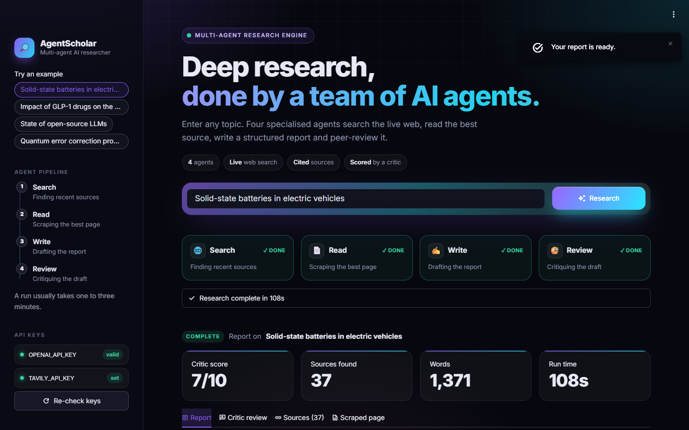
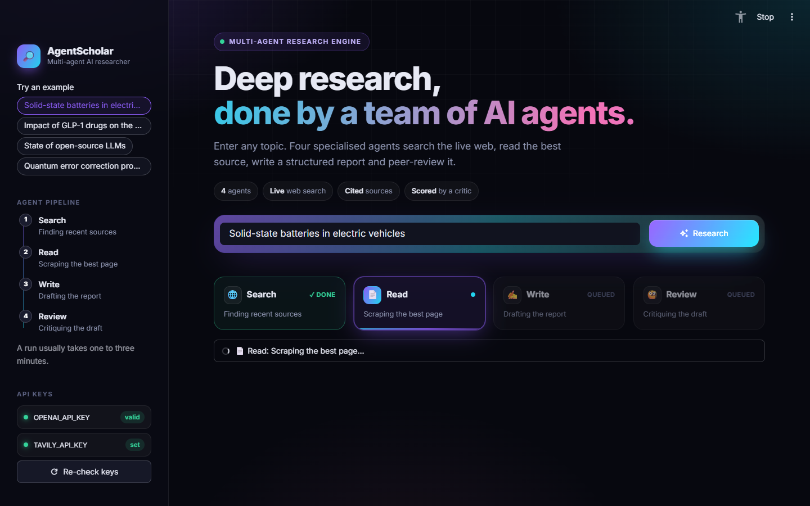
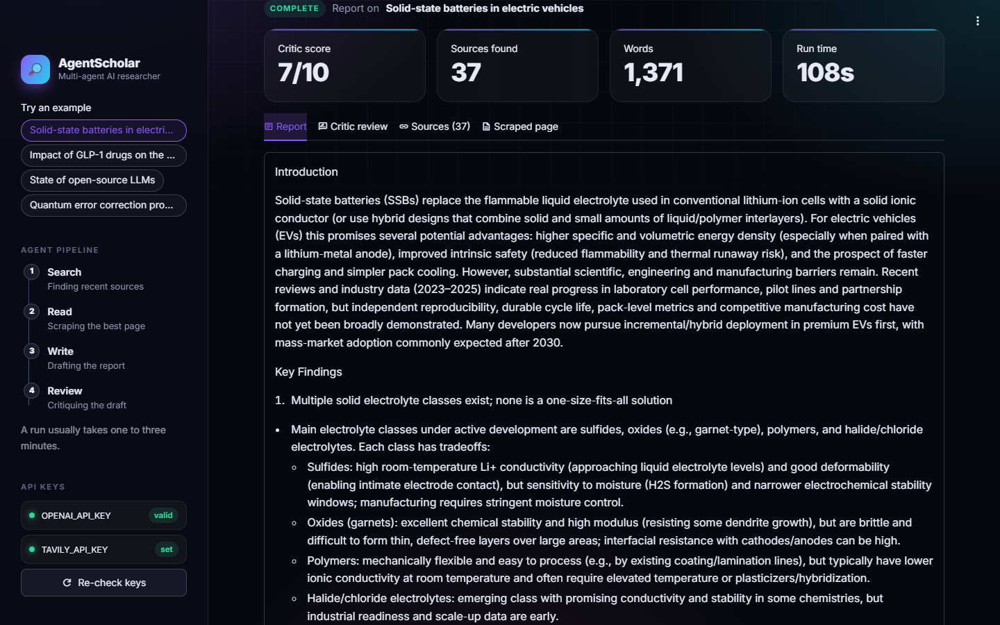
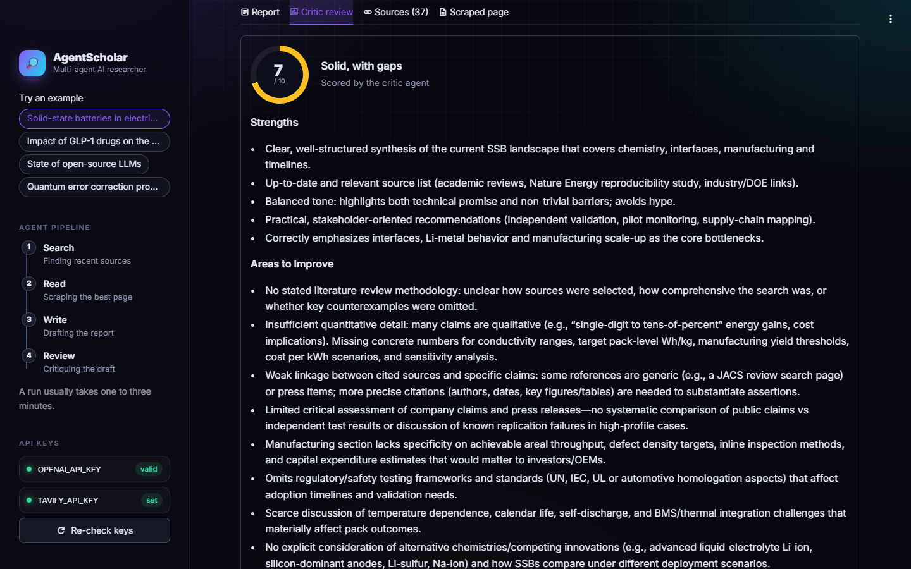
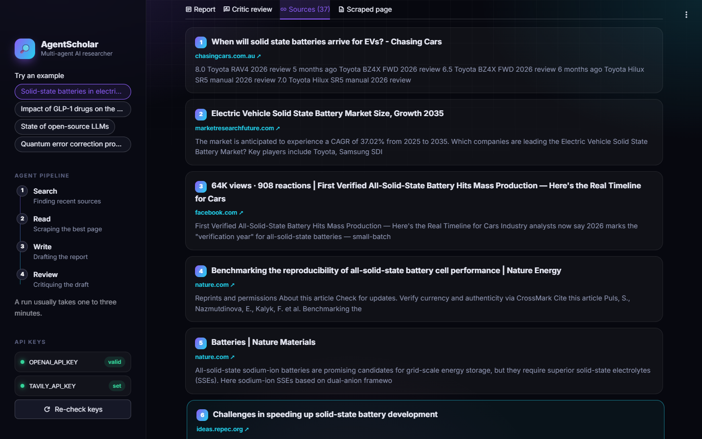
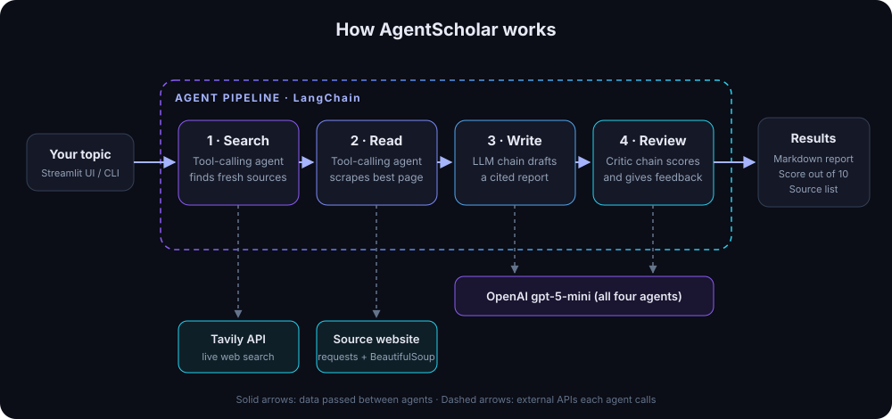

<div align="center">

# 🔎 AgentScholar

**Type a topic. Get a researched, cited and peer-reviewed report in about two minutes, produced by a team of four AI agents.**

[](https://www.python.org/)
[](https://www.langchain.com/)
[](https://platform.openai.com/)
[](https://tavily.com/)
[](https://streamlit.io/)



</div>

---

## 📌 The project in 30 seconds

| | |
|---|---|
| **What it is** | An AI research assistant that works like a small research team. |
| **What you do** | Type a topic, for example *"Solid-state batteries in electric vehicles"*, and click **Research**. |
| **What you get** | A structured report with sources, a quality score out of 10 and a written review, all downloadable as Markdown. |
| **How it works** | Four AI agents run in sequence: **Search** the web → **Read** the best source → **Write** the report → **Review** it. |
| **Built with** | Python · LangChain · OpenAI (gpt-5-mini) · Tavily Search API · BeautifulSoup · Streamlit |

---

## 🎯 Problem statement

Researching a new topic usually means hours of searching, opening dozens of tabs and stitching notes together. Asking a chatbot is faster, but it has three problems:

1. **Outdated:** it only knows what it learned during training.
2. **Unverifiable:** answers usually come without sources.
3. **Unchecked:** nobody reviews the answer before you rely on it.

**AgentScholar addresses all three.** It searches the **live web**, reads a source in full, **cites every URL**, and has a separate **critic agent** grade the report, so you can see how much to trust it.

---

## 🖼️ Screenshots

All screenshots are from real runs of the app.

### Home screen


### Agents at work
A live tracker shows which agent is running. Here **Search** is done and **Read** is scraping the best page.



### The generated report
Summary metrics (critic score, sources, word count, run time) followed by the full report.



### Critic review
An independent critic agent scores the report and lists strengths and areas to improve.



### Sources
Every source the search agent found, each with a clickable link.



### Mobile view
<p align="center">
  
</p>

---

## ✨ Key features

**AI and agents**
- 🤖 **Four specialised agents.** Each one has a single job, which makes the system easier to debug and improve.
- 🌐 **Live web search.** The Tavily Search API brings in recent, relevant sources.
- 📄 **Deep reading.** An agent picks the most relevant page and scrapes its full text.
- ✍️ **Structured reports.** Every report has an introduction, key findings, a conclusion and a source list.
- 🧐 **Automatic quality review.** A critic agent gives a score out of 10 with specific feedback.

**User experience**
- 📊 **Live progress tracker.** See which agent is working at every moment.
- 📈 **Results at a glance.** Tiles show the critic score, source count, word count and run time.
- 💡 **One-click example topics.** Try the app instantly.
- 📥 **Download as Markdown.** Take the report anywhere.
- 📱 **Responsive.** Works on desktop, tablet and phone.
- ♿ **Accessible.** Keyboard focus states, screen-reader progress updates and reduced-motion support.

**Reliability and security**
- 🔑 **API key health check.** The sidebar shows whether each key is *valid*, *set* or *missing* before you run, without revealing the key.
- 🛟 **Clear error messages.** Revoked keys, rate limits and network problems each get a plain-English explanation and a fix.
- 🛡️ **Safe rendering.** Text scraped from the web is HTML-escaped before display, and only `http(s)` links are rendered.

---

## 🏗️ Architecture

<p align="center">
  
</p>

| Step | Agent | What it does | Built with |
|:---:|---|---|---|
| 1 | 🌐 **Search agent** | Decides what to search for and collects the top results (title, URL, snippet). | LangChain tool-calling agent + Tavily |
| 2 | 📄 **Reader agent** | Chooses the most relevant URL and scrapes the page's main text. | LangChain tool-calling agent + `requests` + BeautifulSoup |
| 3 | ✍️ **Writer** | Combines search results and scraped text into a structured, cited report. | LangChain prompt → LLM → output parser |
| 4 | 🧐 **Critic** | Grades the report out of 10 and lists strengths, gaps and a verdict. | LangChain prompt → LLM → output parser |

Steps 1 and 2 are **agents**: the LLM decides when and how to call its tool. Steps 3 and 4 are **chains**: fixed prompt templates with a predictable output format. The web app ([main.py](main.py)) and the command-line version ([pipeline.py](pipeline.py)) both reuse the same agents from [agents.py](agents.py).

---

## 🧰 Tech stack

| Area | Technology | Why it was chosen |
|---|---|---|
| Language | **Python** | The standard language for AI/ML work |
| Agent framework | **LangChain** (`create_agent`, LCEL chains) | Tool-calling agents and composable LLM chains |
| LLM | **OpenAI gpt-5-mini** | Strong reasoning at low cost per run |
| Web search | **Tavily Search API** | Search API designed for AI agents, returning clean results |
| Web scraping | **requests + BeautifulSoup** | Lightweight and reliable extraction of page text |
| Frontend | **Streamlit** + custom CSS | Quick to build a polished, interactive Python web app |
| Configuration | **python-dotenv** | Keeps API keys out of the code |

---

## 📁 Project structure

```
AgentScholar/
├── main.py                # Streamlit web app: UI, progress tracker, results view
├── agents.py              # LLM setup, Search and Reader agents, Writer and Critic chains
├── tools.py               # Agent tools: web_search (Tavily) and url_scrape (BeautifulSoup)
├── pipeline.py            # Command-line version of the same 4-step pipeline
├── .streamlit/
│   └── config.toml        # App theme (dark mode, brand colours)
├── docs/
│   ├── architecture.svg   # Architecture diagram
│   └── screenshots/       # Images used in this README
├── .env.example           # Template for your API keys
├── requirements.txt       # Python dependencies
└── pyproject.toml         # Project metadata
```

---

## 🚀 Getting started

### Prerequisites
- **Python 3.10 or newer**
- An **OpenAI API key**: <https://platform.openai.com/api-keys>
- A **Tavily API key** (the free tier is enough): <https://app.tavily.com>

### 1. Clone the repository
```bash
git clone https://github.com/bhoomikaaa20/MultiAgentSystem.git AgentScholar
cd AgentScholar
```

### 2. Create a virtual environment and install dependencies
```bash
python -m venv .venv

# Windows
.venv\Scripts\activate
# macOS / Linux
source .venv/bin/activate

pip install -r requirements.txt
```

### 3. Add your API keys
```bash
cp .env.example .env
```
Then open `.env` and paste in your keys (see the next section).

### 4. Run the app
```bash
streamlit run main.py
```
Open **http://localhost:8501**, pick an example topic or type your own, and click **Research**.

> **Prefer the terminal?** Run `python pipeline.py` and enter a topic. Each agent's output prints as the pipeline runs.

---

## 🔐 Environment variables

| Variable | Required | What it's for |
|---|:---:|---|
| `OPENAI_API_KEY` | ✅ | Powers all four agents (model: `gpt-5-mini`) |
| `TAVILY_API_KEY` | ✅ | Live web search for the Search agent |

Example `.env`:
```env
OPENAI_API_KEY="your-openai-key"
TAVILY_API_KEY="your-tavily-key"
```

> ⚠️ **Keep your keys secret.**
> - Put real keys **only** in `.env`. It is listed in `.gitignore`, so git won't commit it.
> - Never paste real keys into `.env.example`, the README or any other committed file. OpenAI automatically revokes keys it finds on GitHub, and you would then see `401 token_invalidated`.
> - After editing `.env`, **restart the app** (Ctrl + C, then `streamlit run main.py` again). Keys are read only once, when the app starts.

---

## ☁️ Deployment

### Option 1: Streamlit Community Cloud (free, recommended)
1. Push this repository to GitHub. Your `.env` file stays on your computer.
2. Go to **[share.streamlit.io](https://share.streamlit.io)** → **New app** → select this repo and set the main file to `main.py`.
3. Open **Advanced settings → Secrets** and add:
   ```toml
   OPENAI_API_KEY = "your-openai-key"
   TAVILY_API_KEY = "your-tavily-key"
   ```
4. Click **Deploy**. You get a public URL to share on your résumé or LinkedIn.

### Option 2: Any cloud server (Render, Railway, a VM, …)
Install the requirements, set the two environment variables in the platform's dashboard, and use this start command:
```bash
streamlit run main.py --server.port $PORT --server.address 0.0.0.0
```

---

## 🧠 What this project demonstrates

- **Multi-agent system design:** splitting a complex task across specialised agents that hand results to each other.
- **LLM tool use:** agents that decide for themselves when to call web search and scraping tools.
- **Prompt engineering:** structured prompts that produce consistent, parseable output (report sections, a score out of 10).
- **Real-world API integration:** OpenAI and Tavily, with clear handling of invalid keys, rate limits and network errors.
- **Full-stack delivery:** from agent logic to a polished, responsive and accessible web UI.
- **Security awareness:** secrets kept out of git, and untrusted web content escaped before display.

---

## 🛣️ Future improvements

- [ ] Stream the report word by word as it is written
- [ ] Read and combine several sources instead of one
- [ ] Let the critic's feedback trigger an automatic second draft
- [ ] Save past reports and search through them
- [ ] Export reports as PDF and Word

---

## 👩‍💻 Author

**Bhoomika Somavarapu**
GitHub: [@bhoomikaaa20](https://github.com/bhoomikaaa20)

⭐ If you like this project, consider giving it a star!
