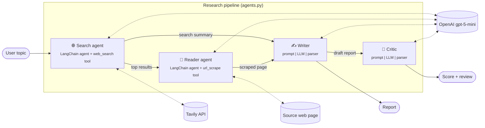

<<<<<<< HEAD
<div align="center">

# 🔎 Research Desk

### A multi-agent AI research assistant that searches, reads, writes and peer-reviews reports on any topic

[](https://www.python.org/)
[](https://www.langchain.com/)
[](https://platform.openai.com/)
[](https://tavily.com/)
[](https://streamlit.io/)


</div>

---

## Table of contents

- [Overview](#overview)
- [Problem statement](#problem-statement)
- [Key features](#key-features)
- [Screenshots](#screenshots)
- [Architecture](#architecture)
- [Tech stack](#tech-stack)
- [Project structure](#project-structure)
- [Getting started](#getting-started)
- [Environment variables](#environment-variables)
- [Usage](#usage)
- [Deployment](#deployment)
- [Design decisions](#design-decisions)
- [Roadmap](#roadmap)
- [Author](#author)

---

## Overview

**Research Desk** turns a single topic into a sourced, structured research report in a few minutes. Instead of one large prompt, it splits the work across **four specialised AI agents** that each do one job well. The same idea underpins most production agent systems:

| # | Agent | Responsibility | Tools |
|---|-------|----------------|-------|
| 1 | 🌐 **Search agent** | Finds recent, reliable sources on the topic | Tavily web search |
| 2 | 📄 **Reader agent** | Picks the most relevant source and scrapes it in depth | `requests` + BeautifulSoup |
| 3 | ✍️ **Writer** | Drafts a structured report (intro, key findings, conclusion, sources) | LLM chain |
| 4 | 🧐 **Critic** | Scores the report out of 10 and lists strengths and gaps | LLM chain |

The project ships with a polished **Streamlit web app** and a **command-line pipeline** that share the same agents.

## Problem statement

Researching an unfamiliar topic means hours of searching, opening tabs, skimming articles and stitching notes together. Asking a chatbot directly is faster but brings its own problems:

- **Stale knowledge.** The model only knows what it was trained on.
- **No sources.** Claims are hard to verify.
- **No quality check.** The output is never reviewed before you rely on it.

Research Desk addresses each of these. It grounds the report in **live web results**, reads a **primary source in full**, **cites URLs**, and runs every draft past an independent **critic agent**, so you can see how trustworthy the report is before you use it.

## Key features

- **Multi-agent pipeline.** Search → Read → Write → Review, with each agent focused on one task.
- **Live web grounding.** Tavily search returns fresh results, and the reader agent scrapes the best page for depth.
- **Structured, cited reports.** Every report has an introduction, at least three key findings, a conclusion and a source list.
- **Built-in quality review.** A critic agent returns a score out of 10, strengths, areas to improve and a one-line verdict.
- **Live progress tracking.** An animated four-step tracker and an expandable run log show which agent is working.
- **Results at a glance.** Metric tiles for critic score, source count, report length and run time.
- **Export.** Download any report as Markdown with one click.
- **Light and dark mode.** Custom components adapt to the Streamlit theme you choose.
- **Responsive.** Layouts adapt from wide desktop screens down to phones.
- **Accessible.** Visible keyboard focus, `aria-live` progress updates, labelled controls and `prefers-reduced-motion` support.
- **Safe rendering.** Scraped titles and snippets are HTML-escaped, and only `http(s)` links are rendered.
- **Configuration health check.** The sidebar shows whether the required API keys are set, without revealing them.

## Screenshots

| Light mode | Dark mode |
|:---:|:---:|
|  |  |

<p align="center">
  <br>
  <em>Mobile layout</em>
</p>

## Architecture



**How data flows**

1. **Search agent:** a tool-calling agent built with `langchain.agents.create_agent`. It decides how to query the `web_search` tool, which wraps Tavily and returns the title, URL and a snippet for the top three results.
2. **Reader agent:** a second agent that receives the search summary, chooses the most relevant URL and calls `url_scrape`. That tool fetches the page, strips scripts, styles, navigation and footers, and returns up to 3,000 characters of clean text.
3. **Writer:** an LCEL chain (`ChatPromptTemplate | ChatOpenAI | StrOutputParser`) that combines the search results and scraped content into a structured Markdown report.
4. **Critic:** a second LCEL chain that evaluates the report against a fixed rubric. The UI parses its output into the score badge and review sections.

The Streamlit UI (`main.py`) and the CLI (`pipeline.py`) orchestrate the same four steps, so the agents are defined once in `agents.py` and reused.

## Tech stack

| Layer | Technology |
|-------|------------|
| LLM | OpenAI `gpt-5-mini` via `langchain-openai` |
| Agent framework | LangChain (`create_agent`, LCEL chains), LangGraph runtime |
| Web search | Tavily (`tavily-python`) |
| Scraping | `requests`, BeautifulSoup 4 |
| Frontend | Streamlit (custom CSS, native status, pills, metrics and tabs) |
| Config | `python-dotenv`, `.streamlit/config.toml` |
| Tooling | `uv` / `pip`, `pyproject.toml` |

## Project structure

```
MultiAgentSystem/
├── main.py               # Streamlit web app: UI, progress tracking, results view
├── pipeline.py           # Command-line version of the same four-step pipeline
├── agents.py             # LLM, search and reader agents, writer and critic chains
├── tools.py              # LangChain tools: Tavily web_search and url_scrape
├── .streamlit/
│   └── config.toml       # Theme (brand colours) and server settings
├── docs/
│   └── screenshots/      # Images used in this README
├── src/multiagentsystem/ # Package entry point (uv project scaffold)
├── .env.example          # Template for required API keys
├── requirements.txt      # Python dependencies
├── pyproject.toml        # Project metadata
└── README.md
```

## Getting started

### Prerequisites

- Python **3.10+** (the project pins 3.14 in `.python-version`)
- An [OpenAI API key](https://platform.openai.com/api-keys)
- A [Tavily API key](https://app.tavily.com) (the free tier is enough)

### Installation

```bash
# 1. Clone the repository
git clone https://github.com/bhoomikaaa20/MultiAgentSystem.git
cd MultiAgentSystem

# 2. Create and activate a virtual environment
python -m venv .venv
# Windows
.venv\Scripts\activate
# macOS / Linux
source .venv/bin/activate

# 3. Install dependencies
pip install -r requirements.txt

# 4. Configure your API keys
cp .env.example .env      # then edit .env with your keys
```

<details>
<summary>Using <code>uv</code> instead of pip</summary>

```bash
uv venv
uv pip install -r requirements.txt
```
</details>

## Environment variables

| Variable | Required | Description |
|----------|:--------:|-------------|
| `OPENAI_API_KEY` | ✅ | Authenticates the OpenAI model used by all four agents. |
| `TAVILY_API_KEY` | ✅ | Authenticates Tavily web search for the search agent. |

Keys are loaded from `.env` by `python-dotenv` at startup. `.env` is listed in `.gitignore`, so never commit it. The app's sidebar shows whether each key is **set** or **missing** and never displays its value.

## Usage

### Web app

```bash
streamlit run main.py
```

Open <http://localhost:8501>, enter a topic or pick an example from the sidebar, and click **Run research**. A run usually takes one to three minutes. Once it finishes you can:

- read the report and **download it as Markdown**
- open **Critic review** for the score and feedback
- browse **Sources** to see every result the search agent found
- check **Scraped page** to see exactly what the reader agent read

### Command line

```bash
python pipeline.py
# Enter a research topic: State of open-source LLMs
```

Each step's output prints to the terminal as the pipeline runs.

## Deployment

### Streamlit Community Cloud (free)

1. Push the repository to GitHub. `.env` is gitignored and stays local.
2. Go to [share.streamlit.io](https://share.streamlit.io), click **New app** and select this repository, with `main.py` as the entry point.
3. Under **Advanced settings → Secrets**, add your keys:
   ```toml
   OPENAI_API_KEY = "sk-..."
   TAVILY_API_KEY = "tvly-..."
   ```
   Streamlit exposes top-level secrets as environment variables, so no code changes are needed.
4. Click **Deploy**.

### Any server or container platform (Render, Railway, a VM, …)

Install the dependencies, set the two environment variables in the platform's dashboard, and start the app with:

```bash
streamlit run main.py --server.port $PORT --server.address 0.0.0.0
```

## Design decisions

- **Specialised agents instead of one prompt.** Smaller, focused prompts are easier to debug and to evaluate, and each step can be swapped out independently.
- **A separate critic.** Self-review in the same prompt tends to be lenient. A separate chain with its own rubric gives a more honest score.
- **A truncated hand-off between agents.** The reader agent receives only the first 800 characters of the search summary, and scraped pages are capped at 3,000 characters. This keeps token costs and latency predictable.
- **One set of agents, two front ends.** The UI and CLI import the same objects from `agents.py`, so behaviour stays consistent.

## Roadmap

- [ ] Stream report tokens to the UI as they are generated
- [ ] Scrape and merge several sources instead of one
- [ ] Let the critic's feedback trigger an automatic revision pass
- [ ] Keep a history of past reports with search
- [ ] Export to PDF and DOCX

## Author

**Bhoomika Somavarapu** · [GitHub @bhoomikaaa20](https://github.com/bhoomikaaa20)

If you found this project interesting, consider giving it a ⭐.
=======
# 🔎 Research Desk — Multi-Agent AI Research Assistant

Research Desk is a **Multi-Agent AI Research Assistant** that automatically searches the web, gathers detailed information from relevant sources, generates a structured research report, and reviews the report using a dedicated AI critic.

The project uses **LangChain, OpenAI, Tavily, web scraping, and Streamlit** to create a complete research workflow powered by multiple specialized AI agents.

---

## 🚀 Features

- 🔎 **AI Web Search Agent** — searches the web for recent and reliable information.
- 📖 **AI Reader Agent** — selects a relevant source and scrapes its webpage for deeper information.
- ✍️ **AI Writer** — combines the gathered research and generates a structured report.
- 🧐 **AI Critic** — reviews the generated report and provides a score, strengths, areas for improvement, and a final verdict.
- 🌐 **Real-time Web Research** using Tavily.
- 📄 **Source Extraction** — displays the URLs and content gathered during research.
- 📥 **Report Download** — download the generated report as a Markdown file.
- 🖥️ **Streamlit Interface** — simple and interactive research dashboard.
- 📊 **Progress Tracker** — shows the current research stage.
- 💡 **Example Topics** — predefined research topics are available for quick testing.

---

## 🧠 How It Works

Research Desk follows a sequential multi-agent workflow:

```text
                 User
                   │
                   ▼
            Enter Research Topic
                   │
                   ▼
        ┌─────────────────────┐
        │  1. Search Agent    │
        │                     │
        │  Searches the web   │
        └──────────┬──────────┘
                   │
                   ▼
        ┌─────────────────────┐
        │  2. Reader Agent    │
        │                     │
        │  Scrapes a relevant │
        │  webpage for detail │
        └──────────┬──────────┘
                   │
                   ▼
        ┌─────────────────────┐
        │  3. Writer Agent    │
        │                     │
        │  Generates report   │
        └──────────┬──────────┘
                   │
                   ▼
        ┌─────────────────────┐
        │  4. Critic Agent    │
        │                     │
        │  Reviews the report │
        └──────────┬──────────┘
                   │
                   ▼
          Final Reviewed Report
```

The same four-step pipeline is also available through the Python pipeline implementation. 

---

## 🤖 AI Agents

### 1. Web Search Agent

The Web Search Agent searches for recent and relevant information about the user's topic.

It uses a custom `web_search` tool powered by **Tavily**.

The search tool returns:

- Title
- URL
- Content snippet

The tool retrieves up to three search results for a query.

---

### 2. Reader Agent

The Reader Agent receives the search results and chooses a relevant URL for deeper analysis.

It then uses the custom `url_scrape` tool to retrieve webpage content.

The scraper:

- Sends an HTTP request to the webpage
- Parses the HTML using BeautifulSoup
- Removes unnecessary elements such as scripts, styles, navigation, and footer sections
- Extracts clean webpage text
- Limits the extracted content for further processing


---

### 3. Writer

The Writer combines the search results and scraped webpage content and generates a professional research report.

The generated report contains:

```text
Introduction
     ↓
Key Findings
     ↓
Conclusion
     ↓
Sources
```

The report prompt specifically requests at least three well-explained key findings and a list of URLs found during research.

---

### 4. Critic

The Critic Agent evaluates the generated report.

It provides:

```text
Score: X/10

Strengths:
- ...
- ...

Areas to Improve:
- ...
- ...

One line verdict:
...
```

This allows the user to understand both the quality of the generated report and what could be improved.

---

## 🖥️ User Interface

The application is built using **Streamlit**.

The interface provides four main sections:

### 📄 Report

Displays the final generated research report.

The report can also be downloaded as a `.md` file.

### 🧐 Critic Review

Displays:

- Report score
- Strengths
- Areas to improve
- Final verdict

### 🔗 Sources

Displays the sources discovered by the Web Search Agent, including:

- Source title
- URL
- Website/domain
- Content snippet

### 📖 Scraped Page

Displays the webpage selected and read by the Reader Agent.

The Streamlit application implements these four result tabs directly.

---

## 🛠️ Tech Stack

### AI / LLM

- Python
- LangChain
- LangChain OpenAI
- LangChain Core
- LangGraph
- OpenAI GPT-5-mini

The project initializes `ChatOpenAI` with the `gpt-5-mini` model and uses LangChain agents for the search and scraping stages.

### Web Research

- Tavily
- Requests
- BeautifulSoup4
- HTTPX

### Frontend

- Streamlit
- HTML
- CSS

### Environment Management

- python-dotenv

### Validation / Utilities

- Pydantic
- typing-extensions
- Rich

The project's dependency file includes these major frameworks and libraries.

---

## ⚙️ Installation

### 1. Clone the repository

```bash
git clone https://github.com/YOUR_USERNAME/research-desk.git
cd research-desk
```

---

### 2. Create a virtual environment

```bash
python -m venv .venv
```

Activate it on Windows:

```bash
.venv\Scripts\activate
```

Activate it on macOS/Linux:

```bash
source .venv/bin/activate
```

---

### 3. Install dependencies

```bash
pip install -r requirements.txt
```

The project dependencies include LangChain, LangChain OpenAI, Tavily, BeautifulSoup, Streamlit, Pydantic, and other supporting libraries.

---

## 🔑 Environment Variables

Create a `.env` file in the project root:

```env
OPENAI_API_KEY=your_openai_api_key
TAVILY_API_KEY=your_tavily_api_key
```

The project loads environment variables using `python-dotenv`.

---

## ▶️ Running the Application

### Streamlit Application

Run:

```bash
streamlit run main.py
```

Then open the Streamlit URL shown in your terminal.

You will see the Research Desk interface.

Enter a topic such as:

```text
Impact of artificial intelligence on healthcare
```

and click:

```text
Run research
```

---

## 💻 Running Without Streamlit

You can also run the research pipeline directly from the terminal.

```bash
python pipeline.py
```

The application will ask:

```text
Enter a research topic:
```

Enter your topic and the pipeline will execute the four stages sequentially.

---

## 🔄 Complete Workflow

When a user enters a topic:

### Step 1 — Search

The Search Agent receives:

```text
Find recent, reliable and detailed information about: <topic>
```

It calls the Tavily search tool and collects relevant sources.

### Step 2 — Read

The Reader Agent receives the search results and selects the most relevant URL.

It then scrapes that webpage for deeper information.

### Step 3 — Write

The Writer receives:

```text
Search Results
+
Detailed Scraped Content
```

and generates the research report.

### Step 4 — Review

The Critic receives the generated report and evaluates it.

Finally, the user receives:

```text
Research Report
+
Sources
+
Critic Score
+
Strengths
+
Areas for Improvement
+
Final Verdict
```

## 👩‍💻 Author

**Bhoomika Somavarapu**

MSc Artificial Intelligence Student

Interested in:

- Artificial Intelligence
- Generative AI
- LLM Applications
- Multi-Agent Systems
- Machine Learning
- Full-Stack Development

---

## ⭐ If You Find This Project Useful

If you found this project interesting or useful, consider giving the repository a ⭐ on GitHub.

---
>>>>>>> 6a8a4cb57e40f8232b33d0b59d8a3ed578194a52
